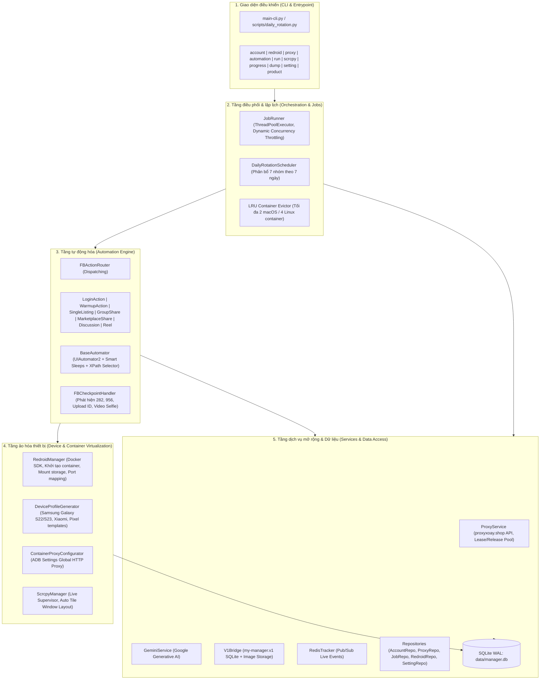
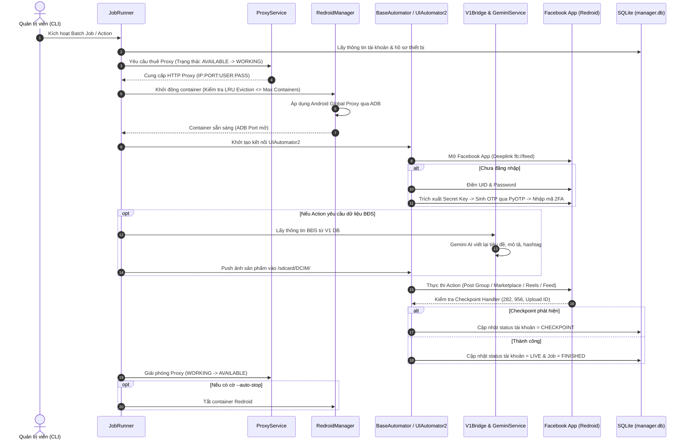

# GEMINI.md - Hướng dẫn Kiến trúc & Vận hành `my-manager.v2`

> Tài liệu kiến trúc toàn diện, cấu trúc thư mục, quy chuẩn code, quản lý môi trường và cẩm nang vận hành cho hệ thống **Redroid Facebook Multi-Account & Automation Manager (`my-manager.v2`)**.

---

## 1. Tổng quan dự án

### 1.1. Mục đích
`my-manager.v2` là hệ thống tự động hóa và quản lý trang trại tài khoản Facebook số lượng lớn trên môi trường Android ảo hóa (**Redroid** - Remote Android in Docker) thông qua **ADB** và **UIAutomator2**.
Hệ thống được thiết kế nhằm thay thế hoàn toàn giải pháp tự động hóa bằng trình duyệt web desktop truyền thống (Playwright, Puppeteer, CloakBrowser), mang lại các ưu thế vượt trội:
- **Chống checkpoint & Trust Score cao**: Sử dụng trực tiếp ứng dụng Facebook Native Android (`com.facebook.katana` / `com.facebook.lite`) trên môi trường Android thật.
- **Giả lập phần cứng trung thực (Hardware Fingerprint Spoofing)**: Mỗi tài khoản sở hữu một hồ sơ thiết bị độc lập (`build.prop`, Android ID, IMEI, MAC Address, Serial, độ phân giải màn hình, DPI).
- **Cách ly mạng tuyệt đối theo container**: Từng instance Redroid được gắn cố định với một HTTP/SOCKS5 xoay thông qua cấu hình Android Global HTTP Proxy hoặc iptables/redsocks2.
- **Tích hợp kho hàng & Gemini AI Content**: Tự động kết nối kho sản phẩm Bất Động Sản từ database của `my-manager.v1`, sử dụng **Google Gemini AI** để tái cấu trúc nội dung, giật tít, sinh hashtag, tự động đăng bài vào Marketplace và Group Facebook.

### 1.2. Tech Stack

| Thành phần | Công nghệ / Thư viện | Vai trò |
| :--- | :--- | :--- |
| **Ngôn ngữ & Runtime** | Python 3.14.7 (Conda Environment) | Ngôn ngữ phát triển chính |
| **Ảo hóa Android** | Docker + `redroid/redroid` (Android 11 / 12 ARM64 & x86_64) | Khởi chạy máy Android ảo nhẹ, hiệu năng cao |
| **Giao tiếp thiết bị** | `adbutils` (ADB client), `uiautomator2` | Kết nối, điều khiển giao diện cảm ứng, tìm kiếm UI element |
| **Giám sát trực quan** | `scrcpy` + AppleScript / X11 window layout | Trình chiếu và tự động sắp xếp cửa sổ màn hình Android theo lưới |
| **Database & ORM** | SQLite 3 (WAL mode) + Pydantic v2 + SQLAlchemy (core) | Lưu trữ thông tin tài khoản, proxy, container, batch jobs |
| **Giao diện CLI** | `typer`, `click`, `rich` | Xây dựng CLI suite mạnh mẽ, bảng hiển thị màu sắc và thanh tiến trình |
| **Bảo mật 2FA** | `pyotp` | Tự động sinh mã xác thực 2 bước (TOTP 6 số) khi đăng nhập |
| **Trí tuệ nhân tạo** | Google Gemini API (gemini-pro / flash) | Viết lại nội dung bài đăng, sinh tiêu đề, đọc hiểu ảnh |
| **Event Broker (Tùy chọn)**| `redis` (Pub/Sub) | Truyền sự kiện tiến trình đa tiến trình/đa terminal theo thời gian thực |
| **Quản lý ảnh / mạng** | `pillow` (PIL), `requests`, `urllib3` | Xử lý ảnh sản phẩm, kiểm tra IP public và gọi API proxy |

### 1.3. Kiến trúc phân tầng (Layered Architecture)



---

## 2. Cấu trúc thư mục chi tiết và vai trò từng thành phần

```
my-manager.v2/
├── main-cli.py                   # Entrypoint CLI chính của toàn bộ hệ thống
├── redroid.yaml                  # Cấu hình máy ảo Lima / VZ Ubuntu VM chạy Redroid trên macOS
├── requirements.txt              # Danh sách thư viện và dependencies Python
├── README.md                     # Tài liệu tổng quan dự án
├── CLIDOCS.md                    # Cẩm nang chi tiết toàn bộ lệnh CLI
├── CLITESTS.md                   # Hướng dẫn test nhanh từng action qua CLI
├── data/                         # Thư mục chứa dữ liệu runtime
│   ├── apks/                     # Chứa APK cài đặt (facebook.apk)
│   ├── containers/               # Mount volume data của từng container: <uid>/
│   ├── logs/                     # Log tạm thời, screenshot lỗi (current_screen.png)
│   └── manager.db                # SQLite database chính của my-manager.v2
├── logs/                         # File log hệ thống và kết quả đăng nhập
│   ├── manager.log               # Log ghi nhận hoạt động chung
│   ├── login_results.log         # Lịch sử chi tiết quá trình đăng nhập
│   └── login_results.json        # Snapshot JSON trạng thái đăng nhập gần nhất
├── scripts/                      # Kịch bản thực thi độc lập (Cronjob / Automation scripts)
│   ├── daily_rotation.py         # Kịch bản xoay vòng tài khoản 7 ngày độc lập cho crontab
│   └── sync_docker_and_v1.py     # Script đồng bộ & tái cấu trúc database từ Docker containers và v1 DB
├── tests/                        # Bộ kiểm thử Unit Tests và công cụ chẩn đoán UI
│   ├── dump_view.py              # Tool chụp màn hình, trích xuất cây UI XML & JSON selector
│   ├── dumps/                    # Dữ liệu dump giao diện qua từng bước automation
│   ├── test_action_router_resilience.py  # Test tính bền vững khi action_name None/lỗi
│   ├── test_check_login.py       # Test luồng nhận diện trạng thái login
│   ├── test_gallery_retry.py     # Test hành vi tương tác ảnh & đóng popup che khuất
│   ├── test_login_action.py      # Test luồng đăng nhập, xử lý 2FA TOTP và checkpoint
│   ├── test_open_facebook_scrcpy.py      # Test khởi chạy app và mở scrcpy
│   ├── test_redroid_eviction.py  # Test cơ chế giải phóng container cũ (LRU)
│   ├── test_redroid_install.py   # Test cơ chế kiểm tra & cài đặt APK Facebook
│   ├── test_reel_interactions.py # Test tương tác Reels (like, comment, share, save)
│   └── test_window_layout.py     # Test thuật toán chia lưới cửa sổ Scrcpy
└── src/                          # Mã nguồn chính của dự án
    ├── __init__.py
    ├── core/                     # Lõi hệ thống: cấu hình, models, giả lập vân tay
    │   ├── constants.py          # Hằng số toàn cục, đường dẫn, port mặc định, giới hạn container
    │   ├── device_templates.py   # Danh sách template mẫu phần cứng (Samsung, Xiaomi, Pixel, v.v.)
    │   ├── fingerprint.py        # Logic sinh DeviceProfile ngẫu nhiên, xuất biến `build.prop`
    │   ├── logger.py             # Cấu hình logging màu sắc (Rich & Standard Logger)
    │   └── models.py             # Pydantic models: Account, Proxy, RedroidInstance, AutomationJob
    ├── db/                       # Cơ sở dữ liệu SQLite & Data Access Layer
    │   ├── database.py           # Khởi tạo kết nối WAL mode, auto migration, bảng biểu
    │   └── repository.py         # Repository pattern: thao tác CRUD cho từng model
    ├── redroid/                  # Điều khiển Container Docker & Giao diện Scrcpy
    │   ├── manager.py            # Khởi tạo, dừng, xóa Docker container, LRU auto eviction
    │   ├── proxy_configurator.py # Thiết lập Android Global Proxy qua lệnh ADB
    │   ├── scrcpy_manager.py     # Process supervisor tự mở/đóng cửa sổ Scrcpy, ẩn phím ảo
    │   └── window_layout.py      # Thuật toán tính toán toạ độ và dàn lưới cửa sổ Scrcpy trên màn hình
    ├── proxy/                    # Quản lý proxy xoay
    │   └── service.py            # Tích hợp API proxyxoay.shop, parse IP:PORT:USER:PASS, xoay IP
    ├── ai/                       # Trí tuệ nhân tạo (Google Gemini AI)
    │   ├── gemini_service.py     # Gọi Gemini API để phân tích hoặc viết lại bài đăng
    │   └── prompt_helper.py      # Mẫu prompt chuyên biệt cho BĐS: Cho thuê, Bán, Sang nhượng
    ├── services/                 # Cầu nối dữ liệu ngoại vi & theo dõi tiến trình
    │   ├── v1_bridge.py          # Đọc dữ liệu sản phẩm, bài viết và kho ảnh từ `my-manager.v1`
    │   └── redis_tracker.py      # Phát Pub/Sub event qua Redis phục vụ theo dõi đa terminal
    ├── utils/                    # Các tiện ích bổ trợ
    │   ├── 2fa.py                # Wrapper trích xuất mã xác thực hai lớp
    │   └── totp.py               # Thuật toán tính toán mã TOTP thời gian thực
    ├── automation/               # Động cơ tự động hóa kịch bản
    │   ├── adb_client.py         # Wrapper thao tác ADB (push file, broadcast scan gallery, shell)
    │   ├── base_automator.py     # Lớp nền UIAutomator2: click, swipe, scroll, gõ phím, chụp ảnh
    │   ├── checkpoint_handler.py # Bộ nhận diện màn hình Checkpoint/Khóa tài khoản
    │   ├── job_runner.py         # Thực thi batch scenario, quản lý luồng song song theo proxy
    │   ├── daily_rotation.py     # Lập lịch xoay vòng tài khoản 7 ngày trong tuần
    │   └── facebook/             # Kịch bản tự động hóa Facebook
    │       ├── router.py         # Bộ định tuyến action (`FBActionRouter`, `execute_action`)
    │       ├── login.py          # Kịch bản đăng nhập, vượt 2FA, lưu session
    │       ├── warmup.py         # Kịch bản lướt bảng tin đơn giản
    │       ├── marketplace.py    # Kịch bản đăng Marketplace cơ bản
    │       └── actions/          # Các Action nghiệp vụ chuyên sâu:
    │           ├── discussion_group.py      # Đăng bài viết dạng thảo luận vào Group
    │           ├── join_group.py            # Tìm kiếm từ khóa và xin vào nhóm Facebook
    │           ├── list_group_share.py      # Đăng niêm yết bán vào nhóm và share chéo N nhóm
    │           ├── list_marketplace_share.py# Đăng bài lên Marketplace và share chéo N nhóm
    │           ├── open_facebook_scrcpy.py  # Mở app Facebook và giữ cửa sổ Scrcpy cho người dùng thao tác
    │           ├── post_group.py            # Đăng bài lên nhóm kèm nội dung và ảnh
    │           ├── reel_interactions.py     # Xem Reels, like, comment, share, save clip
    │           ├── scroll_feed.py           # Lướt Feed tự nhiên, giả lập human delay, thả like
    │           └── single_listing.py        # Đăng thông minh lần lượt qua N nhóm (tự nhận diện Buy/Sell hoặc Thảo luận)
    └── cli/                      # Tầng giao diện dòng lệnh (Typer CLI subcommands)
        ├── account_cmd.py        # Lệnh `python main-cli.py account`
        ├── redroid_cmd.py        # Lệnh `python main-cli.py redroid` & `scrcpy`
        ├── proxy_cmd.py          # Lệnh `python main-cli.py proxy`
        ├── automation_cmd.py     # Lệnh `python main-cli.py automation`, `progress`, `actions`
        ├── run_cmd.py            # Lệnh `python main-cli.py run`
        ├── setting_cmd.py        # Lệnh `python main-cli.py setting`
        └── product_cmd.py        # Lệnh `python main-cli.py product`
```

---

## 3. Quy chuẩn code & Quản lý môi trường

### 3.1. Môi trường phát triển & Conda
- **Môi trường Conda chuẩn**: `my-manager.v2`
- **Đường dẫn môi trường**: `/home/dinhbinhnguyen/miniconda3/envs/my-manager.v2`
- **Phiên bản Python**: `Python 3.14.7` (hỗ trợ các phiên bản Python 3.10+)
- **Kích hoạt môi trường**:
  ```bash
  conda activate my-manager.v2
  ```

### 3.2. Cài đặt Dependencies
Dự án sử dụng file `requirements.txt` ghim chính xác phiên bản các thư viện quan trọng:
```bash
pip install -r requirements.txt
```
> [!NOTE]
> Các thư viện trọng yếu:
> - `docker==7.2.0`: Điều khiển Docker daemon quản lý container Redroid.
> - `uiautomator2==3.7.0`: Engine tương tác giao diện Android qua ADB.
> - `adbutils==2.12.0`: Xử lý kết nối ADB song song tốc độ cao.
> - `typer==0.27.2` & `rich==15.0.0`: Xây dựng CLI và render bảng biểu UI.
> - `pydantic==2.13.5`: Xác thực kiểu dữ liệu cho Models.
> - `PyOTP==2.10.0`: Sinh mã 2FA TOTP.

### 3.3. Yêu cầu hệ điều hành & Virtualization
1. **Host Linux (Ubuntu 22.04 LTS khuyến nghị)**:
   - Cần nạp kernel module `binder_linux` và `ashmem_linux` để Redroid hoạt động:
     ```bash
     sudo apt-get install -y linux-modules-extra-$(uname -r) adb scrcpy
     sudo modprobe binder_linux devices="binder,hwbinder,vndbinder"
     sudo chmod 666 /dev/binder*
     ```
2. **Host macOS (Apple Silicon / Intel qua Lima VM)**:
   - Dự án tích hợp sẵn file `redroid.yaml` để chạy máy ảo Ubuntu 22.04 bằng `limactl`:
     - Khởi động: `mm-start`
     - Dừng giải phóng tài nguyên: `mm-stop`
3. **Giới hạn số lượng Container đồng thời (`MAX_CONCURRENT_REDROID_CONTAINERS`)**:
   - Mặc định: **4 containers trên Linux**, **2 containers trên macOS** (tự động phát hiện trong `src/core/constants.py`).

### 3.4. Quy chuẩn viết code (Coding Standards)
- **Type Annotations**: Mọi schema dữ liệu bắt buộc định nghĩa bằng **Pydantic BaseModel** (`src/core/models.py`).
- **Repository Pattern**: Không viết câu lệnh raw SQL rải rác trong tầng Automation hoặc CLI; toàn bộ truy vấn phải đi qua các lớp tại `src/db/repository.py` (`AccountRepository`, `ProxyRepository`, `AutomationJobRepository`, ...).
- **SQLite Concurrency & WAL Mode**: SQLite được cấu hình tự động bật `PRAGMA journal_mode=WAL;` và `PRAGMA foreign_keys=ON;` cùng timeout 30s. Thao tác ghi dữ liệu sử dụng context manager `get_db_cursor()` tự động commit / rollback an toàn.
- **Action Pattern**: Mọi thao tác trên Facebook phải kế thừa hoặc nhận đối tượng `BaseAutomator`, tuân thủ cấu trúc:
  1. Kiểm tra trạng thái đăng nhập/checkpoint.
  2. Bơm delay ngẫu nhiên (`smart_sleep`) tránh phát hiện bot.
  3. Xử lý selector mềm dẻo (tìm theo XPath, Resource-ID, Content-Desc, Text tương đối).
  4. Bắt lỗi không làm crash luồng chính; tự động dump màn hình lỗi vào `tests/dumps/` khi gặp sự cố.
- **Dọn dẹp tài nguyên (Resource Lease/Release Cycle)**:
  - Khi bắt đầu một Job: Thuê Proxy (chuyển trạng thái sang `working`) -> Khởi chạy container -> Thực thi action.
  - Khi hoàn thành hoặc gặp ngoại lệ (trong khối `finally`): Giải phóng Proxy về `available` -> Tự động tắt container nếu có cờ `--auto-stop`.

### 3.5. Cơ chế Tối ưu Hiệu năng (Performance Optimizations)
Hệ thống đã tích hợp sẵn các cơ chế tối ưu hiệu năng chuyên sâu cho cả môi trường Linux và macOS:
1. **Giới hạn tốc độ khung hình (FPS Throttling)**: Khởi chạy Redroid với `androidboot.redroid_fps=15` (hoặc cấu hình qua biến môi trường `REDROID_FPS`), giảm ngay 50–60% lượng tính toán đồ họa CPU của SwiftShader.
2. **Tắt Animation hệ điều hành Android**: Tự động đặt `window_animation_scale=0`, `transition_animation_scale=0`, `animator_duration_scale=0` ngay sau khi container khởi động (`create_instance` và `start_instance`), giúp giao diện chuyển cảnh tức thì và rút ngắn 15–25% thời gian chạy action.
3. **Độ phân giải chuẩn hóa `720x1280` (`dpi=320`)**: Giảm 2.25 lần lượng pixel phải render so với `1080x1920` mà vẫn giữ nguyên tỉ lệ 9:16 và tương thích hoàn toàn giao diện Facebook.
4. **Giảm tải Scrcpy & Chống Leak File Handle**: Scrcpy giới hạn ở `--max-size 640 --max-fps 15 --video-bit-rate 2M`, đồng thời đóng file descriptor log ở tiến trình cha sau khi spawn process.
5. **Tối ưu hóa UIAutomator2**: Gộp các mẫu Regex kiểm tra tooltip popup thành 1 mẫu biểu thức duy nhất trong `dismiss_listing_tooltip_popups`, giảm số lượt dump XML từ 14 lần xuống còn 2 lần. Tăng chu kỳ background watcher lên 5.0s tránh nghẽn RPC.
6. **Tối ưu bộ nhớ đệm SQLite**: Bổ sung `PRAGMA synchronous=NORMAL;`, `PRAGMA temp_store=MEMORY;`, `PRAGMA cache_size=-64000;` (64MB RAM cache).
7. **Tùy chọn GPU Host trên Linux**: Hỗ trợ kích hoạt tăng tốc phần cứng thông qua biến môi trường `REDROID_GPU_MODE=host` gắn trực tiếp `--device /dev/dri`.
8. **Đồng bộ dữ liệu đa nền tảng**: Kịch bản `scripts/sync_docker_and_v1.py` tự động nhận diện đường dẫn CSDL v1 trên cả macOS và Linux để tái cấu trúc `data/manager.db`.

---

## 4. Các lệnh chạy, test thường dùng

### 4.1. Cấu hình hệ thống ban đầu (`setting`)
```bash
# Xem toàn bộ cấu hình hiện tại
python main-cli.py setting list

# Đặt API Key của Google Gemini AI
python main-cli.py setting set gemini_api_key "AIzaSy..."

# Đặt đường dẫn CSDL và kho ảnh của hệ thống v1 (nếu dùng chung)
python main-cli.py setting set v1_db_path "/home/dinhbinhnguyen/Devs/my-manager.v1/bin/products.db"
python main-cli.py setting set v1_image_dir "/home/dinhbinhnguyen/Devs/my-manager.v1/bin/images"
```

### 4.2. Quản lý Tài khoản Facebook (`account`)
```bash
# Thêm tài khoản mới kèm 2FA và phân loại BĐS (thuê / bán)
python main-cli.py account add --uid "61599900011122" --password "Pass123" --two-fa "JBSWY3DPEHPK3PXP" --category "real_estate" --transaction-type "rental" --note "Account Cho Thue 1"

# Liệt kê danh sách tài khoản (lọc theo trạng thái live, idle, checkpoint)
python main-cli.py account list
python main-cli.py account list --status live

# Xem thông tin chi tiết một tài khoản
python main-cli.py account show 61599900011122

# Phân bổ lại nhóm (group_id = 0 cho lịch xoay vòng)
python main-cli.py account set-group --to 0 --from -1 --limit 50

# Xóa tài khoản (tự động xóa container docker, data volume trên đĩa và giải phóng proxy)
python main-cli.py account delete 61599900011122
```

### 4.3. Quản lý Proxy xoay (`proxy`)
```bash
# Thêm API proxy xoay mới
python main-cli.py proxy add --name "Proxy_01" --url "https://proxyxoay.shop/api/get.php?key=YOUR_KEY"

# Xem danh sách và trạng thái các proxy
python main-cli.py proxy list

# Đổi trạng thái proxy thủ công
python main-cli.py proxy set-status "Proxy_01" available

# Xóa proxy
python main-cli.py proxy delete "Proxy_01"
```

### 4.4. Quản lý Container Redroid & Cài đặt APK (`redroid`)
```bash
# Tạo container mới cho tài khoản (tự động gán proxy và cài Facebook APK)
python main-cli.py redroid create --uid "61599900011122"

# Xem danh sách các container Redroid đang chạy/đã tạo
python main-cli.py redroid list

# Kiểm tra IP public thực tế bên trong container Android
python main-cli.py redroid check-ip

# Cài đặt Facebook APK cho một tài khoản hoặc toàn bộ tài khoản
python main-cli.py redroid install 61599900011122 --apk data/apks/facebook.apk
python main-cli.py redroid install --all --apk data/apks/facebook.apk

# Dừng container (theo UID, Port hoặc dừng tất cả)
python main-cli.py redroid stop 61599900011122
python main-cli.py redroid stop --all

# Xóa hoàn toàn container và dữ liệu trên đĩa
python main-cli.py redroid remove 61599900011122
```

### 4.5. Giám sát màn hình trực tiếp bằng Scrcpy (`scrcpy`)
```bash
# Khởi chạy Supervisor theo dõi thời gian thực (tự mở scrcpy khi container chạy & tự đóng khi dừng)
python main-cli.py scrcpy

# Mở hoặc đóng cửa sổ Scrcpy cho 1 thiết bị cụ thể (theo Port hoặc UID)
python main-cli.py scrcpy 5555 --open
python main-cli.py scrcpy 5555 --close

# Ẩn bàn phím ảo để tránh che khuất các nút bấm của Facebook
python main-cli.py scrcpy -k

# Paste nội dung clipboard máy host vào thiết bị Android
python main-cli.py scrcpy 61599900011122 -P
```

### 4.6. Chạy kịch bản tự động hóa đơn lẻ (`run`)
```bash
# Đăng nhập tự động + vượt 2FA cho tài khoản
python main-cli.py run action --action login --uids "61599900011122"

# Kiểm tra tình trạng đăng nhập của tài khoản
python main-cli.py check-login --uids "61599900011122"

# Đăng bài vào Group và share chéo N nhóm (dùng dữ liệu v1 + Gemini AI)
python main-cli.py run group-share -u "61599900011122" -g 5857815244230418 -s 5 -t rental --use-ai --v1-prod

# Đăng bài lên Marketplace và share chéo N nhóm
python main-cli.py run marketplace-share -u "61599900011122" -l "Đà Lạt" -s 20 -t sale --use-ai --v1-prod

# Đăng bài thông minh N nhóm (tự nhận diện form Buy/Sell hoặc Thảo luận)
python main-cli.py run single-listing -u "61599900011122" -c 3 -t rental --use-ai --v1-prod

# Lướt Feed nuôi tài khoản
python main-cli.py run action --action scroll_feed --uids "61599900011122" --params '{"max_swipes": 25, "min_delay": 3.0, "max_delay": 8.0, "max_likes": 3}'

# Tương tác Reels (thả tim, xem clip, bình luận)
python main-cli.py run action --action reel_interactions --uids "61599900011122" --params '{"reel_id": "123456789", "like": true, "watch_delay": 15.0}'
```

### 4.7. Quản lý kịch bản hàng loạt theo Batch (`automation`)
```bash
# Tạo một batch scenario nhiều bước
python main-cli.py automation create-batch \
  --tag "daily_warmup" \
  --uids "61599900011122,61599900022233" \
  --actions '[{"action": "scroll_feed", "params": {"max_swipes": 20}}, {"action": "join_group", "params": {"group_id": "5857815244230418"}}]' \
  --name "Kịch bản nuôi tài khoản"

# Chạy batch scenario (tự động điều tiết concurrency = min(số_proxy_rảnh, threads))
python main-cli.py automation run-batch --tag "daily_warmup" --threads 2

# Theo dõi tiến độ thời gian thực
python main-cli.py progress --tag "daily_warmup" --system

# Reset lại các job bị lỗi để chạy lại
python main-cli.py automation reset --tag "daily_warmup" --failed
```

### 4.8. Kịch bản xoay vòng 7 ngày trong tuần (`daily-rotation`)
```bash
# Xem trước phân bổ công việc hôm nay (Dry Run)
python main-cli.py run daily-rotation --dry-run

# Chạy thực tế kịch bản hôm nay (concurrency = 1)
python main-cli.py run daily-rotation --concurrency 1

# Thiết lập Crontab tự động chạy mỗi sáng lúc 08:00 AM:
# 0 8 * * * /home/dinhbinhnguyen/miniconda3/envs/my-manager.v2/bin/python /home/dinhbinhnguyen/Devs/my-manager.v2/scripts/daily_rotation.py >> /home/dinhbinhnguyen/Devs/my-manager.v2/logs/daily_rotation.log 2>&1
```

### 4.9. Chẩn đoán & Dump UI Hierarchy (`dump`)
```bash
# Dump màn hình và lấy selector UI qua Port hoặc UID
python main-cli.py dump --port 5555 --tag "debug_step_login"
python main-cli.py dump --uid "61599900011122"

# Kết quả xuất ra tại tests/dumps/<tag>_<timestamp>/:
# - dumped_screen.png: Ảnh chụp màn hình
# - dumped_view.xml: Cây phân cấp UI gốc từ UIAutomator2
# - dumped_view.json: Danh sách interactive elements kèm toạ độ và suggested selector
```

### 4.10. Chạy Kiểm thử Unit Tests
Dự án sử dụng Python `unittest` chuẩn:
```bash
# Chạy toàn bộ các bài test
python -m unittest discover -s tests -p 'test_*.py'

# Chạy riêng từng file test
python -m unittest tests/test_login_action.py
python -m unittest tests/test_action_router_resilience.py
python -m unittest tests/test_redroid_eviction.py
python -m unittest tests/test_window_layout.py
```

---

## 5. Luồng xử lý dữ liệu và Database Schema tóm tắt

### 5.1. Luồng xử lý công việc tự động (Data & Execution Flow)



---

### 5.2. Database Schema tóm tắt (`data/manager.db`)

Cơ sở dữ liệu SQLite được tổ chức tinh gọn, gồm các bảng chính:

#### 1. Bảng `accounts` (Tài khoản Facebook)
Quản lý thông tin định danh, bảo mật, phân nhóm và hồ sơ thiết bị.
- `id`: Khóa chính tự tăng.
- `uid`: Mã Facebook UID duy nhất (bắt buộc).
- `username`: Tên đăng nhập (nếu có).
- `password`: Mật khẩu tài khoản.
- `two_fa`: Khóa bí mật 2FA (Secret Key để tính mã TOTP).
- `email`, `email_password`: Thông tin email khôi phục.
- `status`: Trạng thái (`idle`, `live`, `checkpoint`, `banned`, `warmup`, `error`).
- `group_id`: Mã nhóm phân bổ (mặc định: `0` cho daily rotation).
- `category`: Lĩnh vực kinh doanh (`real_estate`, `tire`, `fashion`).
- `transaction_type`: Loại giao dịch mặc định (`rental`, `sale`).
- `proxy_id`: ID proxy đang liên kết.
- `container_id`: ID container Redroid tương ứng.
- `device_profile_id`: ID hồ sơ thiết bị phần cứng gán cho tài khoản.
- `created_at`, `updated_at`: Dấu thời gian.

#### 2. Bảng `proxies` (Quản lý Proxy xoay)
Quản lý danh mục link API xoay IP từ `proxyxoay.shop`.
- `id`: Khóa chính tự tăng.
- `name`: Tên gợi nhớ của proxy.
- `url`: Link API xoay proxy duy nhất.
- `status`: Trạng thái (`available`: rảnh, `working`: đang dùng, `unavailable`: lỗi/hết hạn).
- `current_proxy_http`: Chuỗi `IP:PORT:USER:PASS` thực tế đang cấp.
- `assigned_account_uid`: UID tài khoản đang thuê proxy này.
- `last_rotated_at`: Lần xoay IP gần nhất.
- `created_at`: Dấu thời gian tạo.

#### 3. Bảng `device_profiles` (Hồ sơ phần cứng thiết bị)
Lưu trữ thông số giả lập phần cứng trung thực gắn với từng account.
- `id`: Mã UUID hồ sơ.
- `brand`, `manufacturer`, `model`, `product`, `device`, `board`, `hardware`: Các trường định danh `build.prop`.
- `fingerprint`: Chuỗi Build Fingerprint chính thống của Android.
- `android_id`: Chuỗi định danh 64-bit Hex Android ID.
- `imei`: Mã IMEI 15 số hợp lệ.
- `mac_address`: Địa chỉ MAC card mạng ảo.
- `serial`: Số serial phần cứng.
- `width`, `height`, `dpi`: Kích thước và mật độ điểm ảnh màn hình.
- `locale`, `timezone`: Mặc định `vi-VN` và `Asia/Ho_Chi_Minh`.

#### 4. Bảng `redroid_instances` (Container Android ảo)
Theo dõi trạng thái và cổng ADB/Scrcpy của từng container Docker.
- `container_id`: Docker Container ID (Khóa chính).
- `container_name`: Tên container (`redroid_fb_<uid>`).
- `adb_port`: Cổng ADB host mở ra (ví dụ: `5555`, `6555`).
- `scrcpy_port`: Cổng Scrcpy host ánh xạ.
- `status`: Trạng thái Docker (`running`, `stopped`, `creating`, `error`).
- `account_uid`: UID Facebook liên kết.
- `proxy_url`: Proxy đang được gán.
- `device_profile_id`: Hồ sơ thiết bị được container nạp lúc `docker run`.

#### 5. Bảng `automation_jobs` (Kịch bản công việc theo lượt)
Quản lý các công việc chạy theo batch, theo dõi tiến độ chi tiết từng bước.
- `id`: Khóa chính tự tăng.
- `name`: Tên mô tả công việc.
- `group_tag`: Nhãn nhóm kịch bản để quản lý batch (`--tag`).
- `account_uid`: UID tài khoản chịu trách nhiệm chạy job.
- `actions_json`: Chuỗi JSON định nghĩa chuỗi các hành động cần chạy.
- `current_step_index`: Bước hiện tại đang thực hiện.
- `current_action`: Tên hành động hiện tại.
- `status`: Trạng thái job (`pending`, `running`, `finished`, `failed`).
- `container_id`: Container ID đang phục vụ job.
- `result_message`: Thông điệp lỗi hoặc kết quả hoàn thành.
- `created_at`, `started_at`, `finished_at`: Dấu thời gian tiến trình.

#### 6. Bảng `settings` (Cấu hình hệ thống)
Cấu hình dạng Key-Value cho phép thay đổi linh hoạt không cần sửa code.
- `id`: Khóa chính.
- `name`: Tên cài đặt duy nhất (`gemini_api_key`, `v1_db_path`, `v1_image_dir`, `container`).
- `value`: Giá trị cài đặt.
- `created_at`, `updated_at`: Dấu thời gian.

#### 7. Bảng `automation_tasks` (Nhiệm vụ đơn lẻ kế thừa)
Lưu trữ nhật ký các tác vụ đơn lẻ rời rạc trong hệ thống.
- `id`: Khóa chính tự tăng.
- `action_name`: Tên action thực hiện.
- `account_uid`: UID tài khoản.
- `status`: Trạng thái (`pending`, `running`, `completed`, `failed`).
- `result_message`: Kết quả thực thi.
- `params`: Tham số truyền vào dạng JSON string.
- `created_at`, `completed_at`: Dấu thời gian.

---
*Tài liệu được sinh tự động và chuẩn hóa bởi **Antigravity** vào ngày 03/11/2026.*
